<h1 align="center">Arthur Serafim Santin</h1>

  Engenharia de Software · UNISATC 
  Desenvolvimento web full-stack — JavaScript, React, Node.js e PostgreSQL.

  
  
  

---

### Sobre

Estudante de Engenharia de Software na UNISATC. Construo aplicações web de ponta a ponta — do modelo de dados no PostgreSQL até a interface — com atenção a testes automatizados e a código sem dependências desnecessárias.

- Atualmente: sistema de controle de estoque em produção, com suíte end-to-end em Playwright rodando no CI.
- Estudando: React, arquitetura de APIs e modelagem de banco de dados.
- Aberto a: estágio e projetos colaborativos.

  

<b>🎣 Pesque uma curiosidade</b> (clique para puxar a linha)

 

> **Lambari:** o gerador de PDF do controle de estoque foi escrito do zero, sem nenhuma biblioteca.

Puxar de novo

 

> **Jundiá:** no meu jogo de pesca, o primeiro peixe é sempre o Teimoso, um jundiá filhote sem um pedaço do rabo. Se você soltar, ele volta gigante na fase 2.

Mais uma vez

 

> **Traíra:** foi uma traíra que arrancou o pedaço do rabo do Teimoso.

Tá beliscando...

 

> **Tilápia:** o TuneIsland não faz nenhuma conexão de rede. Tudo o que ele mostra vem do próprio Windows.

Mordeu!

 

> **Dourado:** o Lembrete Oficina estima quantos km o carro roda por dia para saber quando o cliente deve voltar.

Só mais uma

 

> **Pintado:** a IA do WhatsApp ignora mensagens de qualquer número que não seja o do dono.

Última, prometo

 

> **Bagre:** a arte e os sons de A Última Fisgada são gerados por scripts em Python, não desenhados à mão. Você pescou todos. 🏆

### Stack

**Linguagens**

**Frameworks e ferramentas**

### Projetos

Clique em um projeto para abrir os detalhes. Todos estão também no [portfólio](https://arthurssantin.github.io).

📦 <b><a href="https://github.com/ArthurSSantin/controle-de-estoque">Controle de Estoque de Pneus</a></b> · PWA multiempresa em produção

 

PWA multiempresa para controle de estoque: leitura de código de barras pela câmera, importação de NF-e e planilhas, exportação em `.xlsx`/PDF e dashboard de movimentações. Geradores de XLSX e PDF escritos do zero, sem bibliotecas de terceiros. Isolamento de dados por conta via Row Level Security e suíte E2E em Playwright no CI.

`JavaScript` `Supabase` `PostgreSQL` `Playwright` `PWA` &nbsp;·&nbsp; [demo](https://controle-de-estoque-jade.vercel.app)

🔧 <b><a href="https://github.com/ArthurSSantin/lembrete-oficina">Lembrete Oficina</a></b> · avisa quando o cliente da oficina precisa voltar

 

Registra cada serviço feito no auto center, calcula a próxima visita pelo que vier primeiro (prazo em dias ou quilometragem estimada) e mostra todo dia quem chamar no WhatsApp, com a mensagem pronta. Quando o cliente volta, o retorno aparece na tela de resultados.

`Next.js` `TypeScript` `Supabase` `Vitest` `Playwright` &nbsp;·&nbsp; [demo](https://lembrete-oficina.vercel.app)

🎵 <b><a href="https://github.com/ArthurSSantin/TuneIsland">TuneIsland</a></b> · uma Dynamic Island de música para o Windows

 

Fica no topo da tela e mostra capa, faixa e progresso do Spotify, do navegador ou de qualquer player compatível. Expande ao passar o mouse, ajusta o volume com o scroll, tira a cor de destaque da capa do álbum e some em jogos e vídeos em tela cheia.

`C#` `.NET 8` `WPF` &nbsp;·&nbsp; [download](https://github.com/ArthurSSantin/TuneIsland/releases)

🎣 <b><a href="https://github.com/ArthurSSantin/A-Ultima-Fisgada">A Última Fisgada</a></b> · jogo de pesca 2D sobre um neto, um avô e um açude

 

Começa numa manhã de 2002, com o vô acordando o neto antes do sol. Arremesso com força, minijogo de fisgada, coleção de espécies, e arte e sons gerados por scripts em Python. Portado de um protótipo em Construct 3 para Godot 4.

`Godot 4` `GDScript` `Python`

🗄️ <b><a href="https://github.com/ArthurSSantin/Trabalho_BDD2">Sistema CRM — Varejo</a></b> · a regra de negócio mora no banco

 

CRM de varejo com a regra de negócio implementada no banco — functions, procedures, triggers, índices e views analíticas — consumida por uma API REST em Flask. Inclui painel Cliente 360° com o histórico consolidado de cada cliente.

`PostgreSQL` `plpgsql` `Python` `Flask`

🤖 <b><a href="https://github.com/ArthurSSantin/ia-whatsapp">IA no WhatsApp</a></b> · assistente pessoal que responde no WhatsApp

 

Cloudflare Worker ligado à WhatsApp Cloud API e ao Gemini. Guarda a conversa em KV, aprende fatos sobre o dono com `/eu`, troca de modelo com `/modelo` e ignora mensagens de qualquer outro número.

`JavaScript` `Cloudflare Workers` `Gemini`

⚛️ <b><a href="https://github.com/Jota-Pais/app-aluno-react">App Aluno em React</a></b> · de HTML/CSS/JS para SPA

 

Portabilidade de um app em HTML/CSS/JS para uma SPA em React.

`React` `JavaScript`

---

  Quer conversar sobre estágio ou sobre algum desses projetos? 
  <a href="https://www.linkedin.com/in/arthur-serafim-santin-792900358">Me chama no LinkedIn</a> ou dá uma volta pelo <a href="https://arthurssantin.github.io">portfólio</a>.

